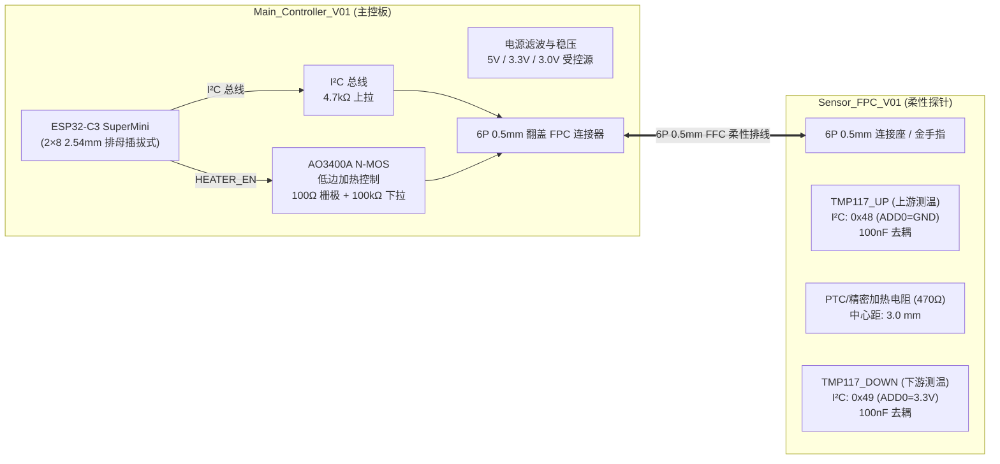
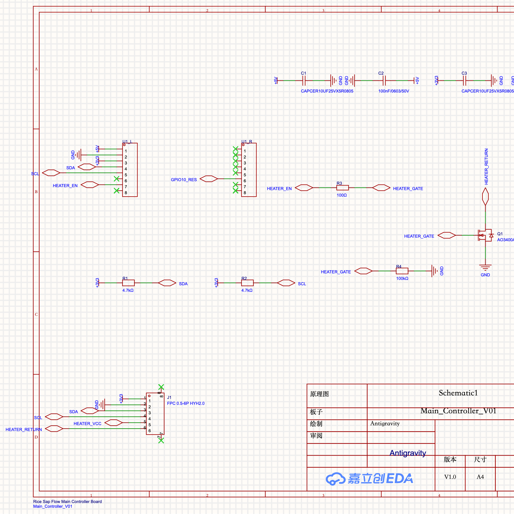
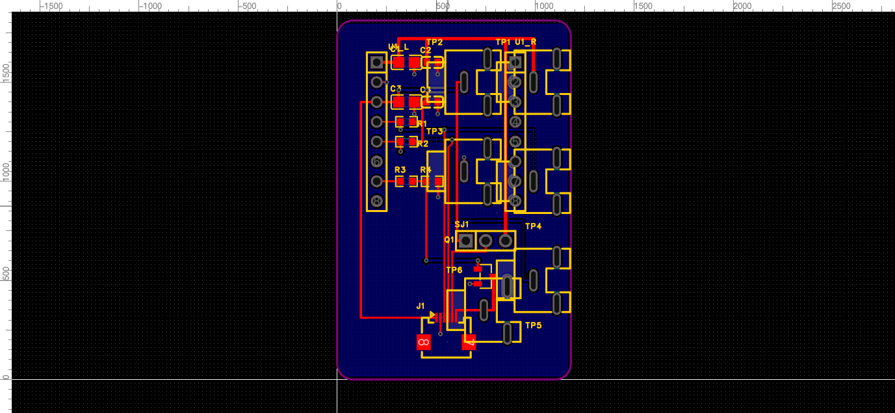
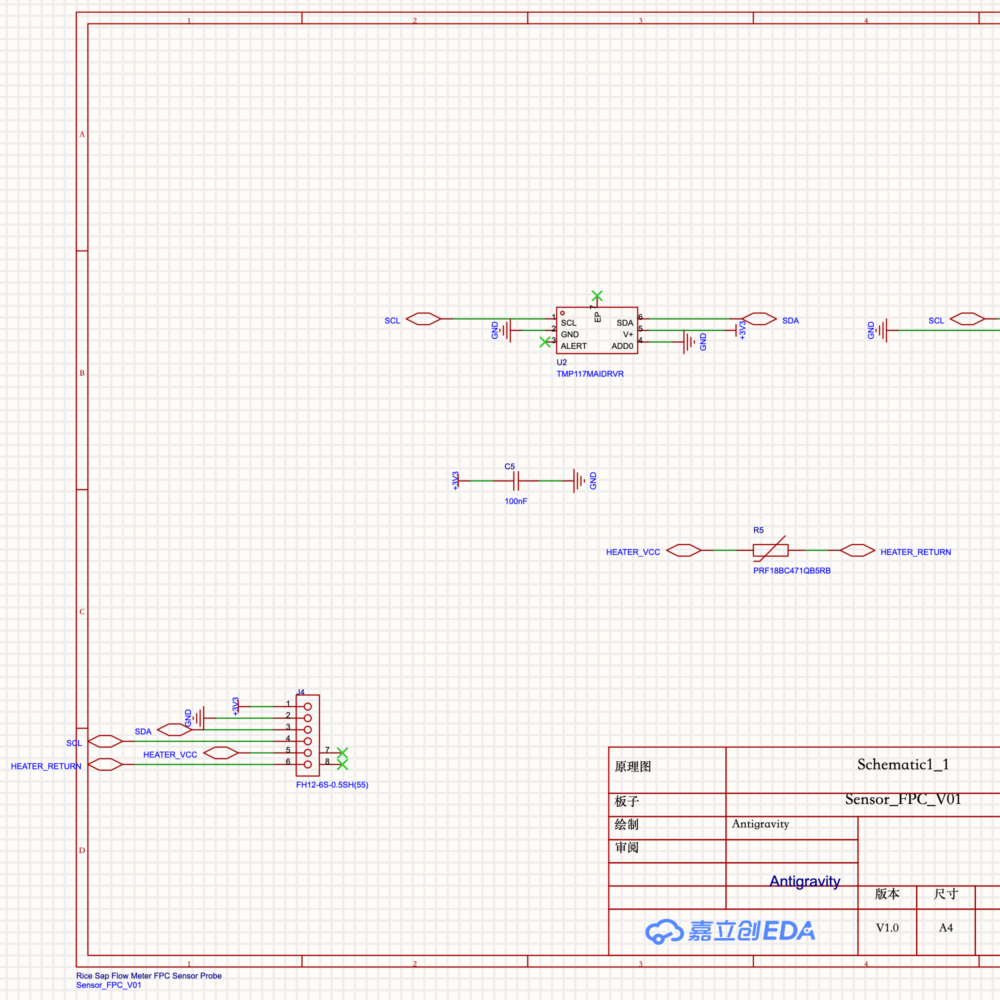
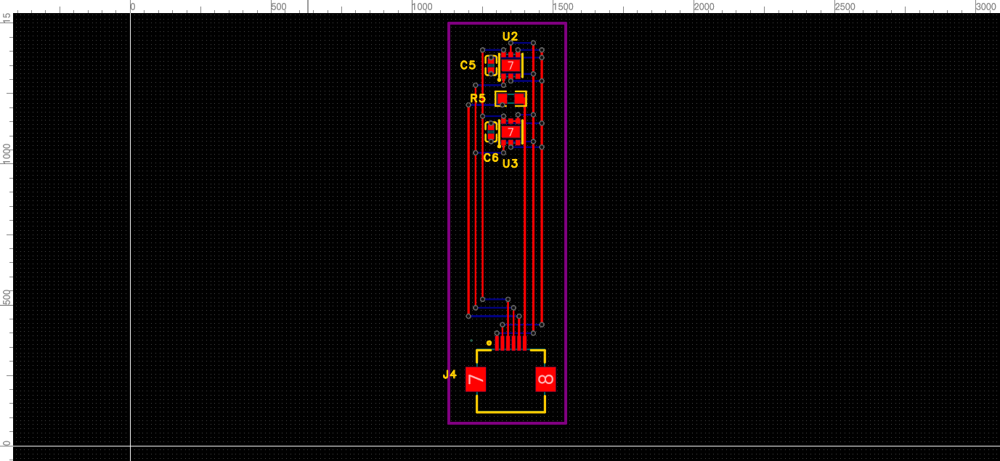

# Rice_SapFlow - 水稻茎流测量系统 (Sap Flow Meter)

[](LICENSE)
[](https://www.espressif.com/)
[](https://lceda.cn/)
[-brightgreen.svg)]()

基于热比法（Heat Ratio Method, HRM）与高精度温度传感器的水稻茎流微脉冲测量系统。包含**主控板 (Main Controller)** 与 **柔性探针板 (Sensor FPC)**，配套基于 ESP32-C3 的双 TMP117 采集与受控热脉冲固件。

---

## 目录
- [系统架构](#系统架构)
- [硬件特性与设计规范](#硬件特性与设计规范)
- [原理图与 PCB 设计](#原理图与-pcb-设计)
- [仓库目录结构](#仓库目录结构)
- [固件与使用说明](#固件与使用说明)
- [制造与打样规范 (JLCPCB)](#制造与打样规范-jlcpcb)
- [验证与交付状态](#验证与交付状态)

---

## 系统架构



---

## 硬件特性与设计规范

### 1. Main_Controller_V01 (主控板)
* **主控模块**：ESP32-C3 SuperMini 插拔模块（2×8 Pin、2.54 mm 间距排针/排母，17.78 mm 跨距）。
* **电源方案**：USB 5V 输入，模块板载稳压输出 3.3V，配有独立受控 3.0V 加热回路及电源去耦网络（10 µF + 100 nF）。
* **低边开关**：AO3400A N-MOSFET，用于加热低边控制；Gate 经 100 Ω 驱动电阻连接 GPIO，100 kΩ 下拉到 GND，确保启动及复位时可靠关断。
* **接口线序 (6P 0.5mm FPC)**：
  1. `+3V3`：传感器供电
  2. `GND`：参考地
  3. `SDA`：I²C 数据
  4. `SCL`：I²C 时钟
  5. `HEATER_VCC`：加热正极
  6. `HEATER_RETURN`：MOSFET 切换的加热回流

### 2. Sensor_FPC_V01 (柔性探针)
* **测温传感器**：2 颗高精度数字温度计 TMP117MAIDRVR (WSON-6, ±0.1°C 精度, 0.0078125°C 分辨率)。
  * 上游传感器 `U2`：ADD0 接地，I²C 地址 `0x48`。
  * 下游传感器 `U3`：ADD0 接 3.3V，I²C 地址 `0x49`。
  * 独立去耦：每颗 TMP117 紧邻配置 100 nF (0402) 陶瓷电容。
* **热隔离设计**：
  * **严格零铜箔隔离区**：传感器与加热源区域**绝对禁止铺铜**，避免横向热窜扰影响植物生理测量。
  * **纯正交对称走线 (Manhattan Routing)**：信号与电源线分置东西双侧走线廊道，中心仅留测温探头。
  * **过孔外移 (Off-Pad Dogbone)**：过孔均放置在焊盘外侧，杜绝回流焊吸锡漏锡风险。

---

## 原理图与 PCB 设计

### 主控板 (Main Controller)
| 原理图 | PCB 布局 |
| :---: | :---: |
|  |  |

### 柔性探针 (Sensor FPC)
| 原理图 | PCB 布局 |
| :---: | :---: |
|  |  |

---

## 仓库目录结构

```text
├── Rice_SapFlow_Optimized.epro2      # 嘉立创 EDA 专业版原生工程交付文件
├── Rice_SapFlow_Optimized_BOM.csv    # 优化版本物料清单 (BOM)
├── Rice_SapFlow_Complete_BOM.csv     # 完整器件选型清单 (含 LCSC 编号)
├── Rice_SapFlow_Complete_Netlist.enet# 嘉立创标准工程完整网络表
├── HANDOVER_TO_CODEX.md              # 工程交接说明与实物验证关键点
├── README.md                         # 项目总览文档 (本文件)
├── docs/                             # 设计文档、优化报告与矢量图表
│   ├── OPTIMIZED_DESIGN.md           # 电路、针脚、操作方法与实物验收步骤
│   ├── Rice_SapFlow_Final_Delivery_Report.md # 终期交付验证报告
│   └── *.svg                         # 高清矢量原理图与布局图
├── firmware/                         # ESP32-C3 采集与热脉冲固件
│   ├── RiceSapFlow/                  # Arduino/ESP-IDF 固件源码
│   │   ├── RiceSapFlow.ino           # 主程序 (WiFi AP, Web UI, CSV, 定时保护)
│   │   └── RiceSapFlow.ino.merged.bin# 可直接烧录的固件镜像
│   └── test_measurement.cpp         # 测量与解析算法主机测试用例
├── fabrication/                      # 嘉立创制造与工艺打样指南
│   └── JLCPCB_Fabrication_Guide.md
├── scripts/                          # 自动化建库、布线与验证脚本
├── design/                           # 参数化设计规范及需求配置
└── verification/                     # 原生 DRC、网表对账与操作审计日志
```

---

## 固件与使用说明

固件源码位于 `firmware/RiceSapFlow/`，使用 Arduino ESP32 Core (v3.3.12) 构建，编译目标 FQBN 为 `esp32:esp32:esp32c3:CDCOnBoot=cdc`。

### 编译与烧录
```bash
# 编译固件
arduino-cli compile --fqbn esp32:esp32:esp32c3:CDCOnBoot=cdc firmware/RiceSapFlow

# 烧录固件
arduino-cli upload -p /dev/tty.usbmodem* --fqbn esp32:esp32:esp32c3:CDCOnBoot=cdc firmware/RiceSapFlow
```

### 操作流程
1. 上电后，串口 (115200 波特率) 输出随机 WiFi 热点 SSID `RiceSapFlow-xxxx` 及动态密码。
2. 手机或电脑连接该热点，在浏览器中访问 `http://192.168.4.1`，输入用户名 `admin` 及热点密码。
3. 网页仪表盘提供：
   - 实时双通道温度与差值曲线（1 Hz 刷新，内部 10 Hz 采样）
   - 单次脉冲触发控制（默认 200 ms，带基线稳定前置检测与硬件定时器超时强制关断保护）
   - 历史温升数据 CSV 下载与状态监控。

---

## 制造与打样规范 (JLCPCB)

1. **主控板 (Main_Controller_V01)**：
   - 结构：双层 FR-4 板，厚度 1.6 mm，1 oz 铜厚。
   - 工艺：无铅喷锡 (Lead-free HASL) 或沉金 (ENIG)，阻焊颜色任意（推荐蓝/绿）。
2. **传感器板 (Sensor_FPC_V01)**：
   - 结构：双面聚酰亚胺 (PI) FPC 软板，基材厚度 0.1 mm，0.5 oz 铜厚。
   - 工艺：**必须选择沉金 (ENIG)**。
   - 补强要求：金手指/接插端背面需贴合 **0.2 mm 聚酰亚胺 (PI) 或 FR-4 补强片 (Stiffener)**，以满足 0.5 mm 间距翻盖式 FPC 插座的 0.3 mm 插合厚度。
   - 贴片提示：TMP117 底部裸露热焊盘（Exposed Pad）首版建议钢网开孔率设为 0%（不涂锡膏），由引脚固定焊接，防止焊锡形成热导旁路。

---

## 验证与交付状态

- **原理图 ERC**：`passed: true, total: 0`（0 悬空引脚、0 悬空网络、0 冲突）。
- **PCB 原生 DRC**：两块板在嘉立创 EDA 专业版中经原生引擎检查，结果均为 `passed: true, violations: []`（**0 错误、0 警告**）。
- **制造规范 (DFM)**：无悬空线、无尖角走线、无间距冲突、丝印均已完成自动避让无压焊盘。
