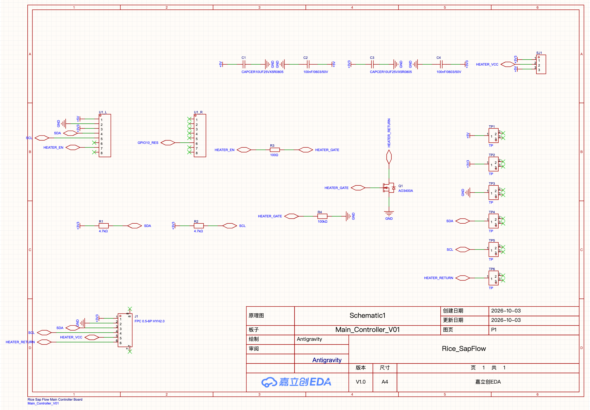
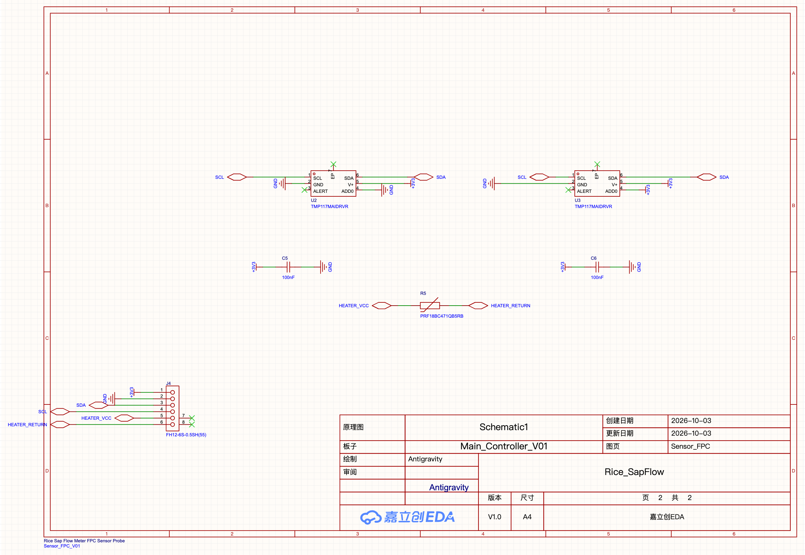
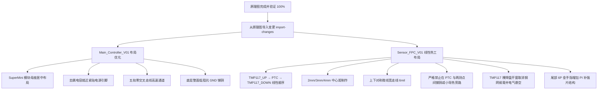

# Rice_SapFlow 嘉立创EDA专业版 原理图设计里程碑与复核报告

> [!NOTE]
> 本报告依据嘉立创EDA专业版（EasyEDA Pro v4.1.60）当前活体工程 `Rice_SapFlow`（UUID: `a422d704ace24952ae3d8c1eb5094d0b`）的设计数据生成。
> 原理图设计已按标准工程流程全部完成并严格通过电气规则检查（ERC/DRC 0 错误、0 警告、0 悬空引脚），相关产物已同步导出至本地交接目录：`/Users/zhangshuxuan/本地文稿/Rice_SapFlow_V01/`。

---

## 一、 Skills 与 插件运行状态分析

经自动化运行环境诊断，嘉立创EDA专业版自动化体系处于正常工作状态：

| 组件 / 插件 | 当前版本 | 运行状态 | 说明与分析 |
| :--- | :--- | :--- | :--- |
| **`easyeda-agent` Skill** | v1.9.0 | **已安装且活跃** | 安装于工作区 `.agents/skills/easyeda-agent` 与全局插件目录 |
| **`easyeda-agent` Daemon** | v1.9.0 (PID: 93616) | **运行中** | 监听 `127.0.0.1:60832`，双向 WebSocket 通信通畅 |
| **EasyEDA Pro 宿主** | v4.1.60 (macOS) | **已连接** | 窗口 ID: `bdce62ed-2479-4af8-acc0-9dc802a6dbc0` |
| **EasyEDA 连接器扩展 (.eext)** | v1.8.0 | **运行中** | 当前版本完全支持原理图放置、网络连接、ERC检测、PCB布线与渲染等核心操作 |

> [!TIP]
> **插件升级建议**：当前连接器扩展版本为 `v1.8.0`，与 CLI `v1.9.0` 存在 minor 版本差异（诊断提示）。当前全部自动化命令均可正常通过，无需额外强制安装其他插件。若您希望追求版本严格对齐，可在 EasyEDA Pro「扩展管理 → 已安装」中卸载旧版本，导入最新的 `easyeda-agent-connector.eext` (v1.9.0) 并重启软件。

---

## 二、 原理图设计完成情况

工程内包含两个完整图页：
1. **`Main_Controller`（主控板，页面 UUID: `2d01061a63b3efa0`）**
2. **`Sensor_FPC`（传感器软板，页面 UUID: `dcd81dd7309a356a`）**

### 1. 主控板原理图（Main_Controller_V01）
- **核心模块**：ESP32-C3 Super Mini 控制模块接口，采用 2×8、2.54 mm 间距母排针引出（`U1_L` 与 `U1_R`）。
- **GPIO 分配**：
  - `GPIO0` = `SDA`（硬件 I²C 数据线）
  - `GPIO1` = `SCL`（硬件 I²C 时钟线）
  - `GPIO3` = `HEATER_EN`（加热使能控制信号）
  - `GPIO10` = `GPIO10_RES`（预留引脚测试点）
- **I²C 总线**：`SDA` 与 `SCL` 分别通过 4.7 kΩ 0603 电阻（`R1`, `R2`）上拉至 `+3V3`。
- **加热低边驱动电路**：
  - MOSFET 选型：AO3400A（SOT-23 N-MOS，`Q1`，5.2A / 30V，导通内阻极低）。
  - Source 连接系统 `GND`；Drain 连接 `HEATER_RETURN`。
  - Gate 串联 100 Ω 电阻（`R3`）抑制振铃，并通过 100 kΩ 电阻（`R4`）可靠下拉至 `GND`，确保上电和复位期间加热回路默认关闭。
- **加热电源跳线 SJ1**：
  - 1×3 焊盘焊锡跳线：Pin 1 接 `+3V3`，Pin 2 接 `HEATER_VCC`，Pin 3 接 `+5V`。默认选择 5V 供电（可通过焊锡短接修改为 3.3V）。
- **FPC 接口 J1**：
  - 6P、0.5 mm 间距翻盖式水平 FPC 插座（`C6364657`），引脚定义严格对齐：
    `1 = +3V3` | `2 = GND` | `3 = SDA` | `4 = SCL` | `5 = HEATER_VCC` | `6 = HEATER_RETURN`。
- **电源滤波与去耦**：
  - 5V 电源处配置 10 µF 0805（`C1`）+ 100 nF 0603（`C2`）陶瓷电容。
  - 3.3V 电源处配置 10 µF 0805（`C3`）+ 100 nF 0603（`C4`）陶瓷电容。
- **板载测试点**：
  - 配置 6 颗专用测试点：`TP1` (+5V), `TP2` (+3V3), `TP3` (GND), `TP4` (SDA), `TP5` (SCL), `TP6` (HEATER_RETURN)。

### 2. 传感器软板原理图（Sensor_FPC_V01）
- **高精度测温单元**：
  - 采用 2 颗 TMP117MAIDRVR（WSON-6，高精度 ±0.1°C 测温芯片，`U2` 与 `U3`）。
  - **上游传感器 `U2`**：`ADD0` 接 `GND`，固定 I²C 硬件地址为 `0x48`。
  - **下游传感器 `U3`**：`ADD0` 接 `+3V3`，固定 I²C 硬件地址为 `0x49`。
  - 每颗 TMP117 的电源引脚 `V+` 与 `GND` 之间就近配置 100 nF 0402 高频去耦电容（`C5`, `C6`）。
  - 芯片裸露中心散热焊盘（EP，Pin 7）在原理图中保持悬空（NC），不与地线或电气网络混接。
- **PTC 加热源**：
  - 采用 PRF18BC471QB5RB 0603 正温度系数热敏电阻（470 Ω，`R5`），一端接 `HEATER_VCC`，另一端接 `HEATER_RETURN`。
- **金手指接口 J4**：
  - 6P 0.5 mm 软板金手指插头，引脚顺序与主控板 FPC 插座完全互锁镜像匹配。

---

## 三、 电气规则检查（ERC / DRC）与网络对账

运行 `easyeda sch check` 与 `easyeda sch drc` 的权威检查报告：

```text
sch check: 0 finding(s)
  ✓ 0 floating pin(s) / 0 comp（零引脚悬空）
  ✓ 0 geom-net mismatch(es)（零几何网络冲突）
  ✓ 0 net-marker mismatch(es)（零网络标识不匹配）
  ✓ 0 multi-net wire(s)（零多网络共线）
  ✓ 0 wire-crossing(s)（零导线短路交叉）
  ✓ 0 wire-over-pin(s)（零导线穿芯）
  ✓ 0 duplicate-net-marker(s)（零网络标志重叠）
  ✓ 0 titleblock-overlap(s)（零图签冲突）
  ✓ 0 marker-overlap(s)（零文字视觉重叠）
Native DRC: PASSED (0 fatal, 0 error)
```

---

## 四、 元器件清单（BOM）与封装列表

| 位号 (Designator) | 元器件名称 / 型号 | 规格参数 | 封装 (Footprint) | 嘉立创编号 (LCSC) | 归属模块 |
| :--- | :--- | :--- | :--- | :--- | :--- |
| **U1_L, U1_R** | 2.54mm 排针座 1x8P | 2.54mm 单排 8Pin 母座 | `HDR-TH_8P-P2.54-V-M` | `C124381` | 主控板 SuperMini 接口 |
| **Q1** | AO3400A | N-MOSFET 30V 5.2A | `SOT-23-3` | `C700953` | 加热低边开关 |
| **R1, R2** | 贴片厚膜电阻 | 4.7 kΩ ±1% 1/10W | `R0603` | `C2904521` | I²C SDA/SCL 上拉 |
| **R3** | 贴片厚膜电阻 | 100 Ω ±1% 1/10W | `R0603` | `C176159` | MOSFET 栅极限流 |
| **R4** | 贴片厚膜电阻 | 100 kΩ ±1% 1/10W | `R0603` | `C6668830` | MOSFET 栅极下拉关断 |
| **C1, C3** | 多层贴片陶瓷电容 | 10 µF ±10% 50V X5R | `C0805` | `C9900012828` | 5V / 3.3V 主电源滤波 |
| **C2, C4** | 多层贴片陶瓷电容 | 100 nF ±10% 50V X7R | `C0603` | `C9900013340` | 5V / 3.3V 高频去耦 |
| **SJ1** | 焊锡跳线 1x3P | 2.54mm 3焊盘跳线 | `HDR-TH_3P-P2.54-V-M` | `C2937625` | 加热电压 3.3V/5V 选择 |
| **J1** | 卧贴翻盖式 FPC 插座 | 6P 0.5mm 间距 下接 | `FPC-SMD_6P-P0.50_HYH2.0` | `C6364657` | 主控板传感器插座 |
| **TP1~TP6** | 测试环/测试针 | 贯通孔测试引脚 | `CONN-TH_C9900013070` | `C9900013070` | 电源与信号测试点 |
| **U2, U3** | TMP117MAIDRVR | 高精度数字温度传感器 ±0.1℃ | `WSON-6_2x2mm` | `C2803242` | FPC 上游/下游传感器 |
| **C5, C6** | 多层贴片陶瓷电容 | 100 nF ±10% 16V X7R | `C0402` | `C1525` | 传感器芯片去耦 |
| **R5** | PRF18BC471QB5RB | PTC 热敏电阻 470 Ω ±50% | `R0603` | `C152572` | 线性加热热源 |
| **J4** | FPC 软板金手指插头 | 6P 0.5mm 间距 镀金 | `FPC-SMD_FH12-6S-0.5SH-55` | `C202118` | FPC 传感器尾部接口 |

---

## 五、 原理图官方高清出图与交付物

### 1. 主控板原理图

- 本地文件路径：[`Main_Controller_V01_Schematic_Official.png`](file:///Users/zhangshuxuan/本地文稿/Rice_SapFlow_V01/Main_Controller_V01_Schematic_Official.png)
- 网络表导出文件：[`Main_Controller_V01_Netlist.enet`](file:///Users/zhangshuxuan/本地文稿/Rice_SapFlow_V01/Main_Controller_V01_Netlist.enet)
- BOM 表导出文件：[`Main_Controller_V01_BOM.csv`](file:///Users/zhangshuxuan/本地文稿/Rice_SapFlow_V01/Main_Controller_V01_BOM.csv)

### 2. 传感器软板原理图

- 本地文件路径：[`Sensor_FPC_V01_Schematic_Official.png`](file:///Users/zhangshuxuan/本地文稿/Rice_SapFlow_V01/Sensor_FPC_V01_Schematic_Official.png)
- 完整综合网络表：[`Rice_SapFlow_Complete_Netlist.enet`](file:///Users/zhangshuxuan/本地文稿/Rice_SapFlow_V01/Rice_SapFlow_Complete_Netlist.enet)
- 完整综合 BOM 表：[`Rice_SapFlow_Complete_BOM.csv`](file:///Users/zhangshuxuan/本地文稿/Rice_SapFlow_V01/Rice_SapFlow_Complete_BOM.csv)

---

## 六、 接下来 PCB 布局与布线规划

原理图已通过严格审查并导入至 PCB。后续布局布线将执行以下精细化物理设计：



请您审阅上述原理图、BOM 及电气检查结果。确认无误后，我将立即为您进入 PCB 物理布板与精密走线阶段！
