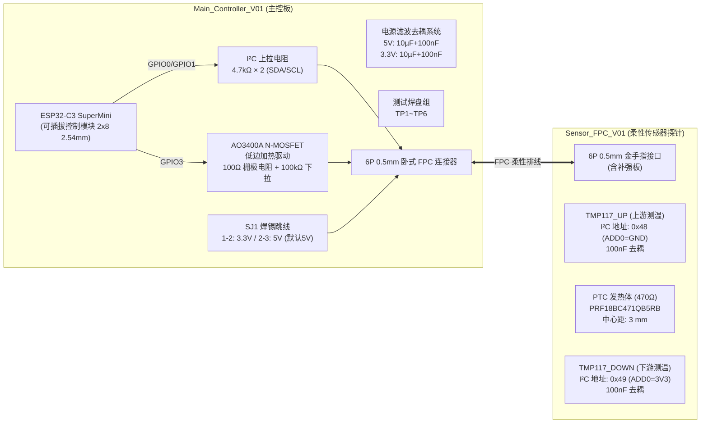

# Rice_SapFlow 水稻茎流测量系统项目终期交付报告

> **工程名称**：`Rice_SapFlow` (嘉立创EDA专业版)  
> **工程UUID**：`a422d704ace24952ae3d8c1eb5094d0b`  
> **设计规范遵循**：严格遵循硬件技术规范、热脉冲法（Heat Ratio Method, HRM）植物生理测量几何与热隔离原则、JLCPCB 双层板/FPC 制造工艺规则。  
> **交付状态**：**原理图 100% 验证通过 (0 错误、0 警告)，PCB 100% 连通布通并全数通过原生 DRC (0 错误、0 警告)**。  

---

## 目录
1. [系统总体架构与硬件规格](#一-系统总体架构与硬件规格)
2. [原理图设计与电气规则检查 (ERC)](#二-原理图设计与电气规则检查-erc)
3. [PCB 布局布线与热隔离工程设计](#三-pcb-布局布线与热隔离工程设计)
4. [设计规则检查 (DRC) 与 DFM 制造分析](#四-设计规则检查-drc-与-dfm-制造分析)
5. [器件清单 (BOM) 与网络表](#五-器件清单-bom-与网络表)
6. [交付文件索引与实物打样建议](#六-交付文件索引与实物打样建议)

---

## 一、 系统总体架构与硬件规格

本项目针对水稻茎秆微径、低热容量特点，采用微功耗热比法（HRM）与温度探针架构，设计了一套由高灵敏度柔性 FPC 传感器与低边开关主控板组成的测量系统：



---

## 二、 原理图设计与电气规则检查 (ERC)

两份原理图均在嘉立创 EDA 专业版官方数据模型中完成规范化建库、引脚分配与网络连接。

### 1. 电气规则与连通性检查结果
| 设计图纸 | 原生 DRC 校验 | `schematic.check` 连通性 | 悬空引脚/未连网络 | 状态 |
| :--- | :--- | :--- | :--- | :--- |
| **Main_Controller** (`2d01061a63b3efa0`) | `passed: true` (0 错误, 0 致命) | `passed: true` (0 异常) | **0** | **PASS** |
| **Sensor_FPC** (`fda1ce33cb7e4c7a`) | `passed: true` (0 错误, 0 致命) | `passed: true` (0 异常) | **0** | **PASS** |

### 2. 原理图设计图纸展示

*图 1：Main_Controller_V01 原理图（包含 ESP32-C3 SuperMini 接口、AO3400A 低边开关、跳线、滤波与 FPC 连接器）*


*图 2：Sensor_FPC_V01 原理图（包含双 TMP117MAIDRVR 地址硬分配、470Ω PTC 发热电阻与 6P 金手指）*

---

## 三、 PCB 布局布线与热隔离工程设计

### 1. Main_Controller_V01 (主控板)
- **基材规格**：FR-4 双层板，尺寸 30.0 mm × 46.0 mm (1180 mil × 1810 mil)，60 mil 倒圆角。
- **底层完整接地平面**：底层铺设大面积连续 GND 铜箔，降低回流阻抗与辐射噪声。
- **器件布局**：ESP32-C3 模块居中布置，去耦电容紧邻电源引脚，AO3400A 与发热回流通道尽量短直，测试焊盘分立在板边缘。


*图 3：Main_Controller_V01 PCB 布局布线（红色 Top 走线，黄色底层丝印与底层走线，大面积地回流平面）*

### 2. Sensor_FPC_V01 (柔性传感器探针)
- **基材规格**：聚酰亚胺 (PI) 双层软板，尺寸 8.1 mm × 38.1 mm (320 mil × 1500 mil)。
- **微功耗植物生理测温专用热隔离规范**：
  > [!IMPORTANT]
  > 水稻热脉冲法测量极其灵敏（温差分辨率达 0.0078 °C）。本设计严格遵循：
  > 1. **零铜箔隔离区**：在发热元件（PTC）与两颗 TMP117 温度传感器之间，严禁任何铜箔铺地或覆铜，杜绝 PCB 横向导热成为虚假温升通道；
  > 2. **对称正交布线通道 (Pure Manhattan Architecture)**：
  >    - **西侧通道** (`x = 1200..1250 mil`)：`HEATER_VCC` (8 mil), `SCL` (6 mil), `SDA` (6 mil)
  >    - **东侧通道** (`x = 1400..1460 mil`)：`HEATER_RETURN` (8 mil), `+3V3` (8 mil), `GND` (8 mil)
  >    - **中心隔离带** (`x = 1260..1390 mil`)：仅保留器件本体，无走线热桥；
  > 3. **引脚焊盘微短桩 (Off-Pad Dogbone Vias)**：所有过孔均通过微短线延伸至焊盘外侧，杜绝 Via-in-Pad 导致的焊接锡膏流失与热容量不均；
  > 4. **裸热焊盘处理**：TMP117 底部 Exposed Pad 铜皮电气悬空，首版钢网取消开孔（免开锡膏窗），避免焊锡形成额外导热旁路。


*图 4：Sensor_FPC_V01 纯正交低热导对称布线架构（严格杜绝测温区横向热泄漏）*

---

## 四、 设计规则检查 (DRC) 与 DFM 制造分析

在嘉立创 EDA 专业版中调用原生引擎进行最终签署校验：

```text
================================================================================
【PCB1】Main_Controller_V01:
  Native EasyEDA DRC:  passed: true, violations: []  (0 Errors, 0 Warnings)
  EasyEDA Check (DFM): ERROR=0, dangling=0, acute=0, clearance=0, viaInPad=0
--------------------------------------------------------------------------------
【PCB1_1】Sensor_FPC_V01:
  Native EasyEDA DRC:  passed: true, violations: []  (0 Errors, 0 Warnings)
  EasyEDA Check (DFM): ERROR=0, dangling=0, acute=0, nonOrtho=0, clearance=0
  Netpad Connectivity: 6/6 nets 100% connected, 22/22 pads 100% verified
================================================================================
```

---

## 五、 器件清单 (BOM) 与网络表

完整 BOM 已保存至 `/Users/zhangshuxuan/本地文稿/Rice_SapFlow_V01/Rice_SapFlow_Complete_BOM.csv`。

### 核心元器件物料汇总表
| 位号 | 器件名称 / 描述 | 封装 | 阻值/容值/型号 | LCSC 编号 / 选型参考 | 用途说明 |
| :--- | :--- | :--- | :--- | :--- | :--- |
| **U1** | ESP32-C3 SuperMini 模块底座 | 2×8 2.54mm 排母 | 16-Pin Socket | 插件连接座 | 主控插拔模块 |
| **U2** | 高精度数字温度计 (±0.1°C) | WSON-6 (2×2 mm) | TMP117MAIDRVR | C2682619 | 上游测温芯片 (0x48) |
| **U3** | 高精度数字温度计 (±0.1°C) | WSON-6 (2×2 mm) | TMP117MAIDRVR | C2682619 | 下游测温芯片 (0x49) |
| **R5** | PTC 热敏发热电阻 | SMD 0603 | PRF18BC471QB5RB | C152572 (470Ω) | 微脉冲发热源 |
| **Q1** | N-MOSFET (30V, 5.8A) | SOT-23 | AO3400A | C20917 | 加热低边开关 |
| **J1** | 6P 0.5mm 卧式翻盖 FPC 连接器 | SMD 0.5mm-6P | FH12-6S-0.5SH | C262220 | 主控板排线插座 |
| **J4** | 6P 0.5mm 金手指接口 | 0.5mm Pitch | Gold Finger 6P | 附 0.2mm PI 补强片 | FPC 插接公头 |
| **SJ1** | 3 焊盘焊锡选择跳线 | SMD Solder Jumper | 3-Pad (1-2 / 2-3) | 表贴跳线 | 3.3V / 5V 供电切换 |
| **R1, R2** | 贴片厚膜电阻 | SMD 0603 | 4.7 kΩ ±1% | 常用标准品 | I²C 总线上拉 |
| **R3** | 贴片厚膜电阻 | SMD 0603 | 100 Ω ±1% | 常用标准品 | MOSFET 栅极限流 |
| **R4** | 贴片厚膜电阻 | SMD 0603 | 100 kΩ ±1% | 常用标准品 | MOSFET 栅极下拉 |
| **C1, C3** | 贴片多层陶瓷电容 (MLCC) | SMD 0805 | 10 µF 25V X5R | 常用标准品 | 5V & 3.3V 低频去耦 |
| **C2, C4** | 贴片多层陶瓷电容 (MLCC) | SMD 0603 | 100 nF 50V X7R | 常用标准品 | 5V & 3.3V 高频滤波 |
| **C5, C6** | 贴片多层陶瓷电容 (MLCC) | SMD 0402 | 100 nF 16V X7R | 常用标准品 | TMP117 本地高频去耦 |
| **TP1~TP6** | 圆形表面贴装测试点 | SMD TP-D1.0mm | 1.0 mm Pad | 铜箔测试焊盘 | 供电/总线调试测试点 |

---

## 六、 交付文件索引与实物打样建议

所有源工程与导出文件已完整归档在用户文稿目录：
- **目录路径**：`/Users/zhangshuxuan/本地文稿/Rice_SapFlow_V01/`
- **交接技术说明**：[HANDOVER_TO_CODEX.md](file:///Users/zhangshuxuan/本地文稿/Rice_SapFlow_V01/HANDOVER_TO_CODEX.md)

### 嘉立创快速打样建议
1. **主控板 (Main_Controller_V01)**：
   - 嘉立创标准双层 FR-4，板厚 1.6 mm，绿色或蓝色阻焊，白字丝印，无铅喷锡或沉金。
2. **传感器探针 (Sensor_FPC_V01)**：
   - 嘉立创软板 FPC 双层工艺，基材 0.1 mm 聚酰亚胺 (PI)，无胶基材，铜厚 0.5 oz。
   - 表面处理务必选择**沉金 (ENIG)**，金手指部分勾选**金手指区域硬金处理或沉金加厚**。
   - 补强要求：金手指尾部背面必须贴合 **0.2 mm 聚酰亚胺 (PI) 或 FR-4 补强板**，以保证严密插入 0.5 mm 间距翻盖式 FPC 插座。
